 
 

 

 
 

 
 

 
 

<table>
  <tr>
    <td align="center" width="160"><b><code>build</code></b></td>
    <td>
      
      
      
      
      
    </td>
  </tr>
  <tr>
    <td align="center"><b><code>cloud · ai</code></b></td>
    <td>
      
      
    </td>
  </tr>
  <tr>
    <td align="center"><b><code>offense</code></b></td>
    <td>
      
      
      
      
      
      
    </td>
  </tr>
</table>

 

 
 

<picture>
  <source media="(prefers-color-scheme: dark)" srcset="https://raw.githubusercontent.com/apiraces-hiberuscom/apiraces-hiberuscom/output/github-snake-dark.svg" />
  <source media="(prefers-color-scheme: light)" srcset="https://raw.githubusercontent.com/apiraces-hiberuscom/apiraces-hiberuscom/output/github-snake.svg" />
  
</picture>

 

© 2026 Alejandro Piracés · <code>think like an attacker, build like an engineer</code>

